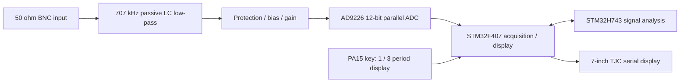

# 周期信号测量分析装置 / Periodic Signal Measurement & Analysis System

**中文** | [English](#english)

一个由 STM32F407 负责高速采集与屏幕交互、STM32H743 负责信号分析的双 MCU 周期信号测量项目。仓库保留了两块控制器的固件、主机自动测试、通信协议和一个可单独复用的 STM32F407 + AD9226 社区驱动。

A dual-MCU periodic-signal measurement project: an STM32F407 handles high-speed acquisition and screen interaction, while an STM32H743 performs signal analysis. The repository contains firmware for both controllers, host-side automated tests, the communication protocol, and a standalone reusable STM32F407 + AD9226 community driver.

项目面向 10 kHz 至 500 kHz 周期信号，设计处理长度为 4096 点，可给出频率、峰峰值、真有效值和最多三个有效分量的分析结果。这些是项目的设计范围，不等于已经完成 10 kHz 至 500 kHz 全频段整机仪器验收；主机合成数据、交叉编译、烧录和真实硬件测量是四种不同层级的证据。

The project targets periodic signals from 10 kHz to 500 kHz with a design processing length of 4096 points, producing frequency, peak-to-peak voltage, true RMS, and up to three dominant spectral components. These are the design scope — they do **not** mean a full 10 kHz–500 kHz instrument acceptance has been completed. Host-synthesized data, cross-compilation, flashing, and real-hardware measurement are four different levels of evidence.

## 系统架构 / System Architecture



数据链路为：50 Ω BNC 输入 → 707 kHz 无源 LC 低通 → 保护、偏置与增益调理 → AD9226 12 位并行 ADC → STM32F407 采集 ↔ STM32H743 信号分析；分析结果回到 F407 后送往 7 英寸 TJC 串口屏显示。

Data path: 50 Ω BNC input → 707 kHz passive LC low-pass → protection / bias / gain conditioning → AD9226 12-bit parallel ADC → STM32F407 acquisition ↔ STM32H743 analysis; results return to the F407 and are shown on a 7-inch TJC serial display.

F407 的 PA15 是低电平按下的物理按键输入，通过 EXTI15 下降沿触发，用于切换串口屏显示 1 个或 3 个波形周期。PA15 原为 JTAG JTDI，当前改作 GPIO/EXTI15；SWD 使用的 PA13/PA14 保留。上图是项目架构示意，不是硬件实物验收证据。

The F407's PA15 is an active-low physical key on EXTI15 falling edge, toggling the display between 1 and 3 waveform periods. PA15 was originally JTAG JTDI and is now GPIO/EXTI15; the SWD pins PA13/PA14 are kept. The diagram above is a conceptual architecture, not physical hardware-acceptance evidence.

## 目录与职责 / Directory Layout

- `AD9226_driver3/AD9226_driver/`：F407 采集端，包含 AD9226 并行采集、双板通信、按键逻辑和 TJC 串口屏显示。
  F407 acquisition side: AD9226 parallel capture, inter-board communication, key logic, and TJC serial display.
- `H743_Signal_Processor/H743_Signal_Processor/`：H743 分析端，包含信号分析算法、通信协议、主机测试和板级固件。
  H743 analysis side: signal-analysis algorithms, communication protocol, host tests, and board firmware.
- `components/ad9226_f407/`：从现有采集实现整理出的独立社区驱动，可复制到其他 STM32F407 HAL 工程；它没有替换现有 F407 固件中的生产实现，也没有因本次整理重新上板验证。
  A standalone community driver extracted from the existing acquisition code, portable to other STM32F407 HAL projects; it does not replace the production implementation in the F407 firmware and was not re-verified on hardware for this release.
- `tools/verify_public_release.ps1`：公开发布前的隐私、路径、探针默认值、JSON 和 README 链接检查。
  Pre-publication checker for privacy, paths, default probe values, JSON validity, and README links.

## VS Code 快速开始 / Quick Start (VS Code)

需要将 `make`、CMake、Ninja、GNU Arm Embedded Toolchain 和 OpenOCD 加入 `PATH`。F407 图形调试还需要 VS Code 的 Cortex-Debug 扩展；CMake Tools 可用于独立组件和主机测试。

Add `make`, CMake, Ninja, the GNU Arm Embedded Toolchain, and OpenOCD to your `PATH`. F407 graphical debugging also needs VS Code's Cortex-Debug extension; CMake Tools can be used for the standalone component and host tests.

1. 打开 `periodic-signal-analyzer.code-workspace`。 / Open the workspace.
2. 按 `Ctrl+Shift+B`，选择 `Build F407` 或 `Build H743 Firmware`。 / Press `Ctrl+Shift+B` and pick `Build F407` or `Build H743 Firmware`.
3. 在 `Terminal -> Run Task` 中选择对应的烧录任务。 / Choose the matching flash task under `Terminal -> Run Task`.
4. 在 `Run and Debug` 中选择 `Debug F407 - ST-Link` 或 `Debug F407 - CMSIS-DAP`。 / Pick `Debug F407 - ST-Link` or `Debug F407 - CMSIS-DAP` under `Run and Debug`.

VS Code 只是 Make、CMake/Ninja、GNU Arm Toolchain 和 OpenOCD 的图形入口，按钮与下面的相对路径命令生成同一固件。没有连接目标板时可以构建，但不要运行烧录或调试任务。

VS Code is only a graphical front-end for Make, CMake/Ninja, the GNU Arm Toolchain, and OpenOCD — the buttons produce the same firmware as the relative-path commands below. You may build without a board attached, but do not run flash or debug tasks.

## 等价命令行 / Equivalent Command Line

### F407 固件 / F407 Firmware

从仓库根目录执行： / Run from the repository root:

```powershell
Set-Location .\AD9226_driver3\AD9226_driver
make -j8
```

单独连接目标 F407 的 ST-Link 时可执行 `make flash`；使用 CMSIS-DAP 时执行 `make flash-cmsis-dap`。如果同时连接了多个 ST-Link，必须显式选择探针：

With a single ST-Link attached to the F407 run `make flash`; with CMSIS-DAP run `make flash-cmsis-dap`. If multiple ST-Links are connected, select the probe explicitly:

```powershell
make flash STLINK_SERIAL_F4=<your-st-link-serial>
```

### H743 固件 / H743 Firmware

H743 的权威构建入口是 `Firmware_H743` 下的 CMake/Ninja 工程，不是该目录中保留的旧 Makefile。仍从仓库根目录执行：

The authoritative H743 build entry is the CMake/Ninja project under `Firmware_H743`, not the legacy Makefile kept in that directory. Still run from the repository root:

```powershell
cmake -S .\H743_Signal_Processor\H743_Signal_Processor\Firmware_H743 -B .\work\h743-firmware-release -G Ninja -DCMAKE_BUILD_TYPE=Release '-DCMAKE_TOOLCHAIN_FILE=cmake/arm-none-eabi-toolchain.cmake'
cmake --build .\work\h743-firmware-release --parallel
```

单独连接目标 H743 的 ST-Link 后，等价烧录命令为： / With a single ST-Link on the H743, the equivalent flash command is:

```powershell
openocd -f interface/stlink.cfg -c "transport select hla_swd" -f target/stm32h7x.cfg -c "program {.\work\h743-firmware-release\H743_Signal_Processor_Firmware.elf} verify reset exit"
```

同时连接多个 ST-Link 时，必须在 `interface/stlink.cfg` 之后增加 `-c "adapter serial <your-st-link-serial>"`。烧录前先确认目标探针和芯片 ID；F407 与 H743 的 ELF、目标配置和探针选择不能混用。

With multiple ST-Links connected, add `-c "adapter serial <your-st-link-serial>"` after `interface/stlink.cfg`. Verify the target probe and chip ID before flashing; the F407 and H743 ELF files, target configs, and probe selections must not be mixed.

## 主机测试 / Host Tests

以下命令只处理主机合成输入、协议和算法，不会连接或烧录开发板：

The commands below only process host-synthesized inputs, protocols, and algorithms — they do not connect to or flash a board:

```powershell
cmake -S .\AD9226_driver3\AD9226_driver\tests\host -B .\work\f407-host -G Ninja
cmake --build .\work\f407-host --clean-first
ctest --test-dir .\work\f407-host --output-on-failure

cmake -S .\H743_Signal_Processor\H743_Signal_Processor -B .\work\h743-host -G Ninja -DCMAKE_BUILD_TYPE=Release
cmake --build .\work\h743-host --clean-first
ctest --test-dir .\work\h743-host --output-on-failure

cmake -S .\components\ad9226_f407\tests -B .\work\ad9226-component -G Ninja
cmake --build .\work\ad9226-component --clean-first
ctest --test-dir .\work\ad9226-component --output-on-failure
```

独立复用说明见[独立 AD9226 F407 社区驱动](components/ad9226_f407/README.md)。

Standalone reuse is documented in the [standalone AD9226 F407 community driver](components/ad9226_f407/README.md).

## 证据矩阵 / Evidence Matrix

| Evidence | 当前含义与边界 / Current meaning and boundary |
|---|---|
| Host tested | F407 6/6、H743 11/11、独立 AD9226 组件 2/2 的主机自动测试已通过；只覆盖合成输入、协议和算法行为。 F407 6/6, H743 11/11, and standalone AD9226 component 2/2 host tests pass; they cover only synthetic inputs, protocol, and algorithm behavior. |
| ARM build verified | F407 与 H743 的 GNU Arm 交叉编译和链接已通过；只证明当前源码能生成目标固件。 F407 and H743 GNU Arm cross-compilation and linking pass; this only proves the current source builds into the target firmware. |
| Flash verified（历史记录 / historical） | 2026-08-01 曾有一次更早的 F407 ELF 写入并校验成功记录。该记录未随本公开版本保留可核对的 ELF/hash，因此不绑定当前源码或当前构建产物，也不构成本次发布状态的烧录证据；本次公开整理没有重新烧录，H743 也没有在本次流程中烧录。烧录成功只证明当时固件被写入并校验，不代表测量正确。 A record from 2026-08-01 shows an earlier F407 ELF was written and verified. No verifiable ELF/hash is retained with this public release, so it does not bind to the current source or build artifacts and is not flash evidence for this release; this cleanup did not reflash either target, and the H743 was not flashed in this workflow. Successful flashing only proves the firmware was written and verified then, not that measurements are correct. |
| Hardware measurement pending | 仍需用信号源、示波器和屏幕实测确认采样时钟、并行数据时序、串口显示、频率/幅值精度以及 10 kHz 至 500 kHz 范围表现。 Real measurement with a signal generator, oscilloscope, and display is still needed to confirm sample clock, parallel data timing, serial display, frequency/amplitude accuracy, and 10 kHz–500 kHz behavior. |

报告中的数值表只可理解为既有主机算法示例，不能据此声称电压误差、抗干扰能力或 2 秒响应已经由这次代码整理重新完成整机实测。

The numeric tables in the reports are existing host-algorithm examples only; they do not establish that voltage error, interference rejection, or the 2-second response were re-verified on hardware by this code cleanup.

## 已知限制 / Known Limitations

- 4096 点和最多三个有效分量是当前处理设计边界；弱谐波是否可靠出现仍受采样链路、窗函数、动态范围和检测保护条件影响。
  4096 points and at most three dominant components are the current processing design boundary; whether weak harmonics appear reliably still depends on the sampling chain, window function, dynamic range, and detection-guard conditions.
- 独立驱动示例默认使用 GPIOC 连续 12 位并行输入与 TIM1/DMA，移植时必须按实际板卡核对电平、供电、时钟树、DMA 映射和引脚。
  The standalone driver example uses GPIOC contiguous 12-bit parallel input with TIM1/DMA by default; when porting, verify levels, power, clock tree, DMA mapping, and pins against the actual board.
- 多探针环境不能依赖自动选择。应先识别目标板，再提供对应 ST-Link 序列号；CMSIS-DAP 未配置显式选择时只连接目标探针。
  Multi-probe environments cannot rely on auto-selection. Identify the target board first, then provide the matching ST-Link serial; CMSIS-DAP connects to the target probe only when explicit selection is configured.
- 主机测试、ARM 构建和成功烧录都不能替代整机测量记录。
  Host tests, ARM builds, and successful flashing cannot replace a full instrument measurement record.

## 许可证与第三方材料 / License and Third-Party Material

项目贡献者原创且未另行声明许可证的文件按根目录 [MIT License](LICENSE) 发布。STM32Cube、STM32 HAL、CMSIS 和其他第三方文件继续受各自文件头、目录许可证及随附条款约束，MIT 不会重新授权这些文件。完整边界见 [THIRD_PARTY_NOTICES.md](THIRD_PARTY_NOTICES.md)。

Files originally authored by the project contributors and not otherwise licensed are released under the [MIT License](LICENSE) in the repository root. STM32Cube, STM32 HAL, CMSIS, and other third-party files remain subject to their own headers, directory licenses, and accompanying terms; MIT does not re-license those files. See [THIRD_PARTY_NOTICES.md](THIRD_PARTY_NOTICES.md) for the full boundary.

项目曾适配康威科技 AD9226 V1.4 模块。仓库中的独立驱动是项目贡献者编写的社区驱动，不是康威科技官方软件；厂商和产品名称仅用于说明硬件兼容性。仓库不包含厂商原理图、PCB、PDF 或从厂商资料直接复制的图片。

The project has been adapted to a Kowloon/康威科技 AD9226 V1.4 module. The standalone driver in this repository is a community driver written by the project contributors, not Kowloon official software; vendor and product names are used only to describe hardware compatibility. The repository contains no vendor schematics, PCB files, PDFs, or images copied from vendor material.

---

## English

# Periodic Signal Measurement & Analysis System

This is a dual-MCU periodic-signal measurement project: an **STM32F407** handles high-speed acquisition and screen interaction, while an **STM32H743** performs signal analysis. The repository contains firmware for both controllers, host-side automated tests, the communication protocol, and a standalone reusable STM32F407 + AD9226 community driver.

The project targets periodic signals from **10 kHz to 500 kHz** with a design processing length of **4096 points**, producing frequency, peak-to-peak voltage, true RMS, and up to three dominant spectral components. These are the *design scope* — they do **not** mean full 10 kHz–500 kHz instrument acceptance has been completed. Host-synthesized data, cross-compilation, flashing, and real-hardware measurement are four different levels of evidence.

## System Architecture


Data path: 50 Ω BNC input → 707 kHz passive LC low-pass → protection / bias / gain conditioning → AD9226 12-bit parallel ADC → STM32F407 acquisition ↔ STM32H743 analysis; results return to the F407 and are shown on a 7-inch TJC serial display.

The F407's **PA15** is an active-low physical key on EXTI15 falling edge, toggling the display between 1 and 3 waveform periods. PA15 was originally JTAG JTDI and is now GPIO/EXTI15; the SWD pins PA13/PA14 are kept. The diagram above is a conceptual architecture, not physical hardware-acceptance evidence.

## Directory Layout

- `AD9226_driver3/AD9226_driver/` — F407 acquisition side: AD9226 parallel capture, inter-board communication, key logic, and TJC serial display.
- `H743_Signal_Processor/H743_Signal_Processor/` — H743 analysis side: signal-analysis algorithms, communication protocol, host tests, and board firmware.
- `components/ad9226_f407/` — a standalone community driver extracted from the existing acquisition code, portable to other STM32F407 HAL projects; it does not replace the production implementation in the F407 firmware and was not re-verified on hardware for this release.
- `tools/verify_public_release.ps1` — pre-publication checker for privacy, paths, default probe values, JSON validity, and README links.

## Quick Start (VS Code)

Add `make`, CMake, Ninja, the GNU Arm Embedded Toolchain, and OpenOCD to your `PATH`. F407 graphical debugging also needs VS Code's Cortex-Debug extension; CMake Tools can be used for the standalone component and host tests.

1. Open `periodic-signal-analyzer.code-workspace`.
2. Press `Ctrl+Shift+B` and pick `Build F407` or `Build H743 Firmware`.
3. Choose the matching flash task under `Terminal -> Run Task`.
4. Pick `Debug F407 - ST-Link` or `Debug F407 - CMSIS-DAP` under `Run and Debug`.

VS Code is only a graphical front-end for Make, CMake/Ninja, the GNU Arm Toolchain, and OpenOCD — the buttons produce the same firmware as the relative-path commands below. You may build without a board attached, but do not run flash or debug tasks.

## Equivalent Command Line

### F407 Firmware

Run from the repository root:

```powershell
Set-Location .\AD9226_driver3\AD9226_driver
make -j8
```

With a single ST-Link attached to the F407 run `make flash`; with CMSIS-DAP run `make flash-cmsis-dap`. If multiple ST-Links are connected, select the probe explicitly:

```powershell
make flash STLINK_SERIAL_F4=<your-st-link-serial>
```

### H743 Firmware

The authoritative H743 build entry is the CMake/Ninja project under `Firmware_H743`, not the legacy Makefile kept in that directory. Still run from the repository root:

```powershell
cmake -S .\H743_Signal_Processor\H743_Signal_Processor\Firmware_H743 -B .\work\h743-firmware-release -G Ninja -DCMAKE_BUILD_TYPE=Release '-DCMAKE_TOOLCHAIN_FILE=cmake/arm-none-eabi-toolchain.cmake'
cmake --build .\work\h743-firmware-release --parallel
```

With a single ST-Link on the H743, the equivalent flash command is:

```powershell
openocd -f interface/stlink.cfg -c "transport select hla_swd" -f target/stm32h7x.cfg -c "program {.\work\h743-firmware-release\H743_Signal_Processor_Firmware.elf} verify reset exit"
```

With multiple ST-Links connected, add `-c "adapter serial <your-st-link-serial>"` after `interface/stlink.cfg`. Verify the target probe and chip ID before flashing; the F407 and H743 ELF files, target configs, and probe selections must not be mixed.

## Host Tests

The commands below only process host-synthesized inputs, protocols, and algorithms — they do not connect to or flash a board:

```powershell
cmake -S .\AD9226_driver3\AD9226_driver\tests\host -B .\work\f407-host -G Ninja
cmake --build .\work\f407-host --clean-first
ctest --test-dir .\work\f407-host --output-on-failure

cmake -S .\H743_Signal_Processor\H743_Signal_Processor -B .\work\h743-host -G Ninja -DCMAKE_BUILD_TYPE=Release
cmake --build .\work\h743-host --clean-first
ctest --test-dir .\work\h743-host --output-on-failure

cmake -S .\components\ad9226_f407\tests -B .\work\ad9226-component -G Ninja
cmake --build .\work\ad9226-component --clean-first
ctest --test-dir .\work\ad9226-component --output-on-failure
```

Standalone reuse is documented in the [standalone AD9226 F407 community driver](components/ad9226_f407/README.md).

## Evidence Matrix

| Evidence | Current meaning and boundary |
|---|---|
| Host tested | F407 6/6, H743 11/11, and standalone AD9226 component 2/2 host tests pass; they cover only synthetic inputs, protocol, and algorithm behavior. |
| ARM build verified | F407 and H743 GNU Arm cross-compilation and linking pass; this only proves the current source builds into the target firmware. |
| Flash verified (historical) | A record from 2026-08-01 shows an earlier F407 ELF was written and verified. No verifiable ELF/hash is retained with this public release, so it does not bind to the current source or build artifacts and is not flash evidence for this release; this cleanup did not reflash either target, and the H743 was not flashed in this workflow. Successful flashing only proves the firmware was written and verified then, not that measurements are correct. |
| Hardware measurement pending | Real measurement with a signal generator, oscilloscope, and display is still needed to confirm sample clock, parallel data timing, serial display, frequency/amplitude accuracy, and 10 kHz–500 kHz behavior. |

The numeric tables in the reports are existing host-algorithm examples only; they do not establish that voltage error, interference rejection, or the 2-second response were re-verified on hardware by this code cleanup.

## Known Limitations

- 4096 points and at most three dominant components are the current processing design boundary; whether weak harmonics appear reliably still depends on the sampling chain, window function, dynamic range, and detection-guard conditions.
- The standalone driver example uses GPIOC contiguous 12-bit parallel input with TIM1/DMA by default; when porting, verify levels, power, clock tree, DMA mapping, and pins against the actual board.
- Multi-probe environments cannot rely on auto-selection. Identify the target board first, then provide the matching ST-Link serial; CMSIS-DAP connects to the target probe only when explicit selection is configured.
- Host tests, ARM builds, and successful flashing cannot replace a full instrument measurement record.

## License and Third-Party Material

Files originally authored by the project contributors and not otherwise licensed are released under the [MIT License](LICENSE) in the repository root. STM32Cube, STM32 HAL, CMSIS, and other third-party files remain subject to their own headers, directory licenses, and accompanying terms; MIT does not re-license those files. See [THIRD_PARTY_NOTICES.md](THIRD_PARTY_NOTICES.md) for the full boundary.

The project has been adapted to a Kowloon (康威科技) AD9226 V1.4 module. The standalone driver in this repository is a community driver written by the project contributors, not Kowloon official software; vendor and product names are used only to describe hardware compatibility. The repository contains no vendor schematics, PCB files, PDFs, or images copied from vendor material.
